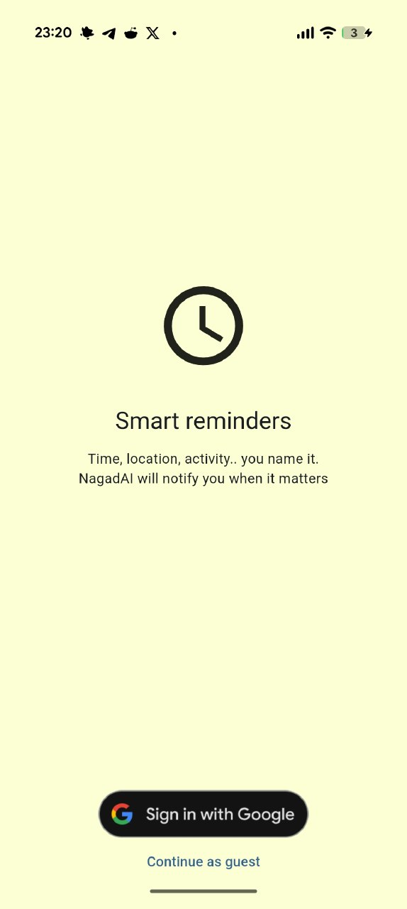
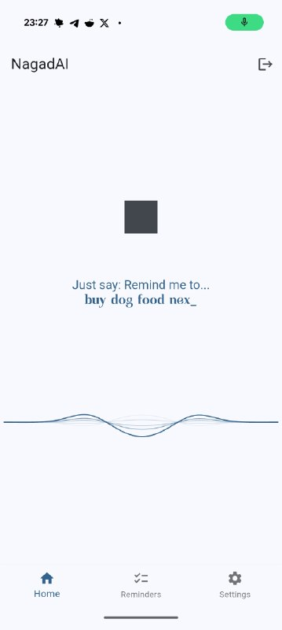
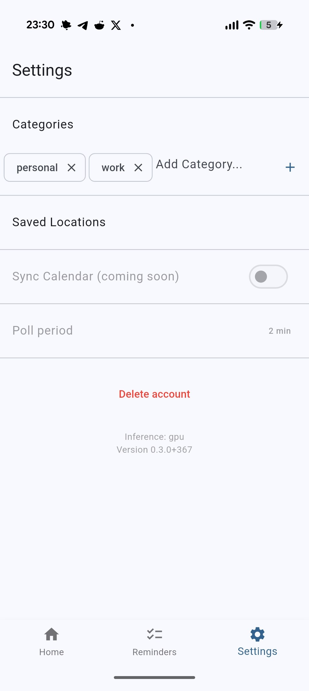
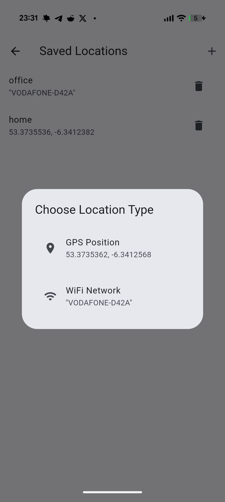

# NagadAI

Flutter mobile application for smart context-aware reminders using Gemma 4 on the edge device.

[](https://trello.com/b/Oq9W55RI/nagadai)

## Install

App has been published in Google Play for closed testing.

To get to the app, your email needs to be added to the list of testers. Email me at nagadai@chaplyk.com to be added to the list.

[](https://play.google.com/apps/internaltest/4701638909643361559)

## Screenshots

| Login | Home | Settings | Locations |
|---|---|---|---|
|  |  |  | 

## Build and run on a connected Android phone

1. Connect the phone via USB and enable USB debugging
2. Verify the phone is detected:
   ```sh
   flutter devices
   ```
3. Build apk:
   ```sh
   make build
   ```
4. Run directly on the connected phone:
   ```sh
   make run
   ```

## Wear OS companion

`android/wear` is a small watch app: a **New reminder** Tile with a mic button. Tap it, speak, and the
text is sent to the phone, which parses and saves it like any other reminder, even if the app is closed.
If the phone is out of range, Wear OS keeps the text and delivers it later.

```sh
make build-wear                     # build/wear/outputs/apk/debug/wear-debug.apk
adb -s <watch> install -r build/wear/outputs/apk/debug/wear-debug.apk
```

The watch app must have the same application id **and signing key** as the phone app, or the two can't
talk (use debug with debug or release with release). Add the Tile by long-pressing the watch face, or from the Wear OS app on the phone.
